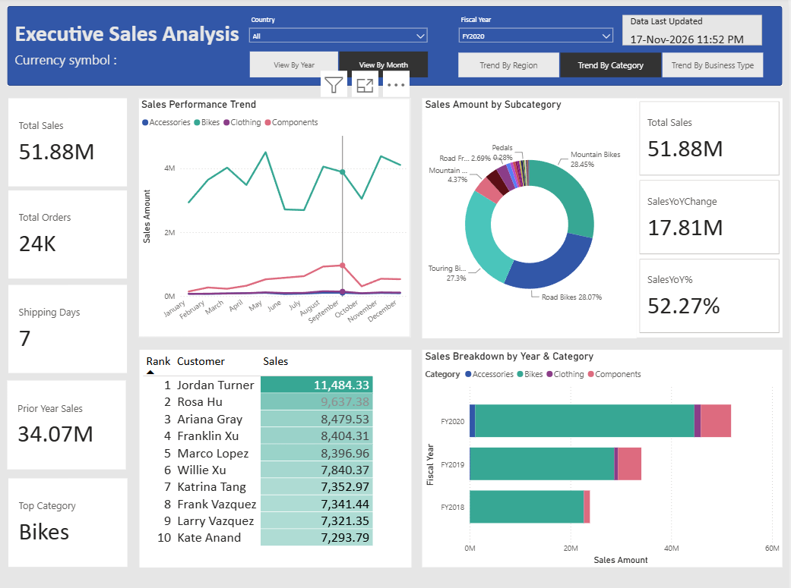
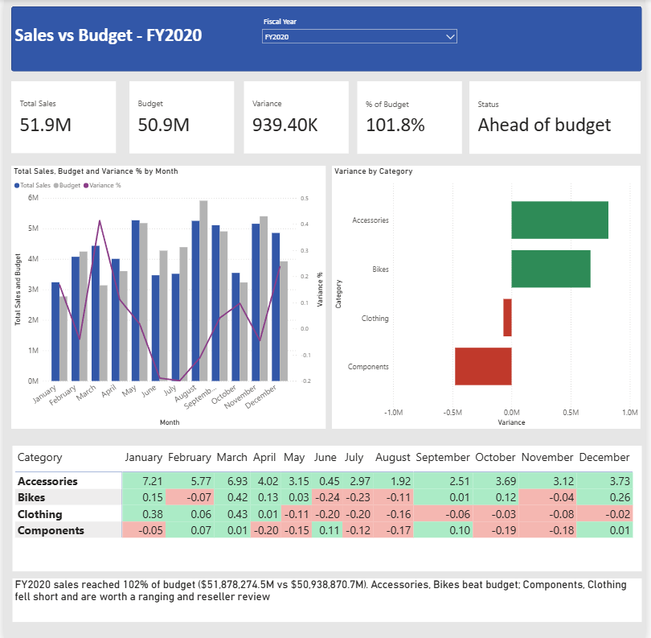
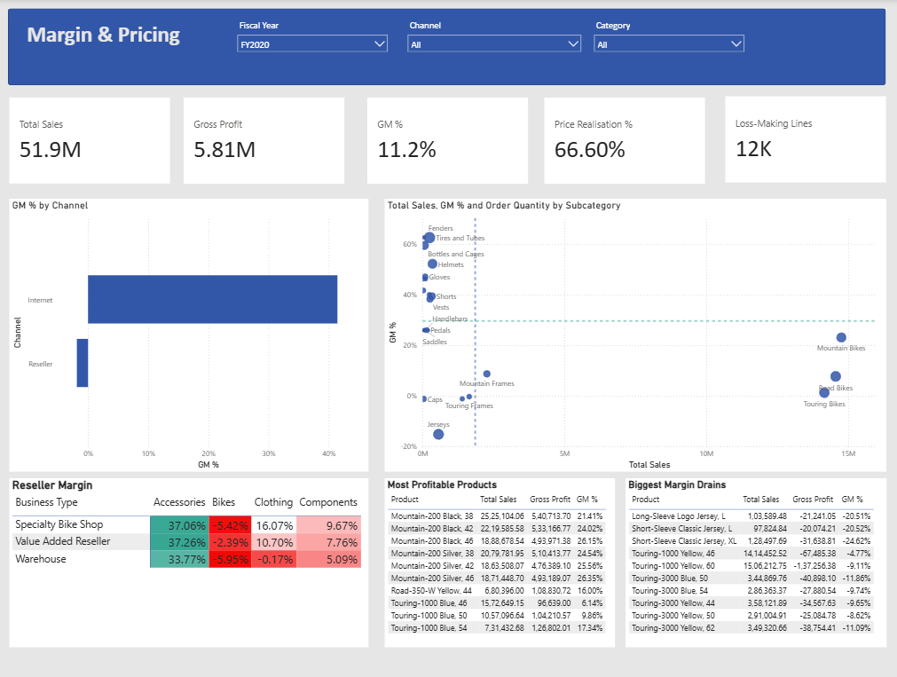
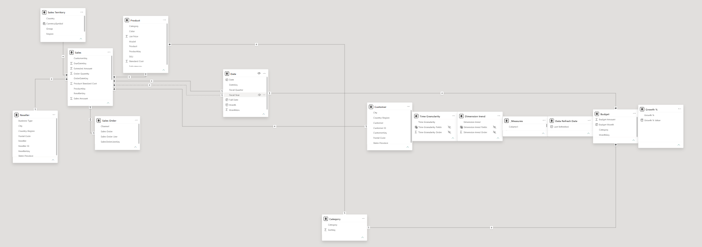

# FY2020 Sales Performance Review – Power BI

An interactive Power BI report that reviews a year of sales for a bike company that sells **wholesale through resellers** and **direct to customers online**. It covers sales performance, actual vs budget, and margin and pricing, for July 2017 – June 2020 (three Australian financial years, July to June).

**Tools:** Power BI (DAX, Power Query, data modelling), Excel (PivotTables, XLOOKUP, GETPIVOTDATA, Power Query)
**Data:** Microsoft AdventureWorks sample data: 121,253 order lines, 31,455 orders, 397 products, 702 resellers, $109.8M in sales

---

## Report pages

### 1. Executive Sales Analysis


- Total sales, prior-year sales and year-on-year growth for the selected financial year
- Monthly sales trend with switchable time level (day, month, year) and breakdown (category and more) using field parameters
- Top 10 customers, sales by category and subcategory, average shipping days

### 2. Sales vs Budget


- Actual sales vs a **bottom-up budget built in Excel** (by month and category for FY2019 and FY2020)
- Variance in $ and %, % of budget achieved, and red/green status by category and month
- **Key finding (FY2020):** sales reached about 102% of budget. Bikes and Accessories beat budget, while Components and Clothing fell short.

### 3. Margin & Pricing


- Gross profit, gross margin %, and price realisation (how much of the list price was actually charged)
- Quadrant chart of subcategories by sales and margin, to support range decisions
- Reseller margin by business type and category, plus top and bottom 10 products by profit
- **Key finding (FY2020):** online sales earn about **41% margin** at full list price, but the **reseller channel runs at about –2% margin** because resellers pay on average about 42% below list price. Reseller trade terms would be the first thing to review.

### 4. Sales Details
Drill-through table of individual order lines (customer, product, region, order and ship dates).

---

## Data model



A star schema with **Sales** as the central fact table, linked to Date, Product, Customer, Reseller, Sales Territory and Sales Order, plus a **Budget** table loaded from Excel and a shared Category table so actuals and budget filter together.

- Date table uses an **Australian financial year (July – June)**
- One **Fiscal Year slicer is synced across pages**, so selecting a year updates every page, including the budget comparison
- Page titles and commentary are DAX measures, so they update with the selected year

---

## How the budget was built (Excel)

The file `Sales_Budget.xlsx` contains the budget workings:

1. **Assumptions** – growth % per category and financial year, with the reason for each assumption
2. **Actuals** – prior-year sales by month and category (PivotTable, using XLOOKUP helper columns)
3. **Budget Calc** – budget = same month last year × (1 + growth %), using GETPIVOTDATA and XLOOKUP
4. **Budget** – Power Query unpivots the budget into a 96-row table (24 months × 4 categories) that Power BI loads

To test a different budget, change the growth % on the Assumptions sheet, then **Data → Refresh All** in Excel and **Refresh** in Power BI.

---

## Key DAX measures

```DAX
Variance % = DIVIDE([Total Sales] - [Budget], [Budget])

Gross Profit = [Total Sales] - [Total Cost]
GM % = DIVIDE([Gross Profit], [Total Sales])

List Price Value = SUMX(Sales, Sales[Order Quantity] * RELATED(Product[List Price]))
Price Realisation % = DIVIDE([Total Sales], [List Price Value])

Sales YoY % = DIVIDE([Total Sales] - [Prior Year Sales], [Prior Year Sales])
```

---

## Files in this repository

| File | What it is |
|---|---|
| `Sales_Performance_Review.pbix` | The Power BI report (open with Power BI Desktop, free) |
| `Sales_Budget.xlsx` | Source data plus the budget workings |
| `screenshots/` | Images of each report page and the data model |

---

## Notes

- Sales data ends on 15 June 2020, so June 2020 is a partial month.
- AdventureWorks is Microsoft sample data. Its costs and prices aren't realistic, so the reseller margin finding shows the analysis method rather than a real business result.

---

## In progress: FY2021 Sales Forecast page

- Monthly forecast by category: same month last year × (1 + growth %), so the seasonal pattern carries through
- Growth % **scenario slider** (0–60%) to test different outlooks
- **Backtest:** the same method applied to FY2020 and compared with actual sales, to measure forecast accuracy
- Power BI's built-in statistical forecast shown alongside as a second opinion
